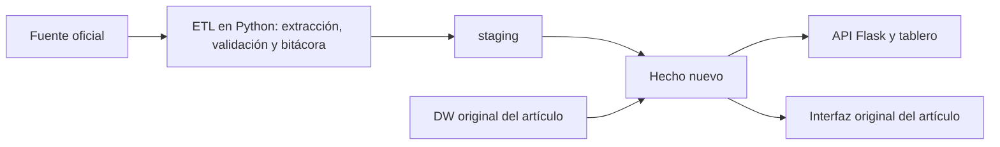

# Fuentes alternas para tres data warehouses

Integración de datos oficiales y citables en los data warehouses de tres artículos académicos: un catálogo sísmico, el consumo de agua de la Ciudad de México y la obra pública municipal. Cada sistema conserva el modelo original del artículo y le agrega un hecho nuevo, cargado desde una fuente pública. La carga se hace con un ETL reproducible y verificable de la fuente a la API.

Práctica de Bases de Datos · Escuela Superior de Cómputo (ESCOM), IPN.

| Agua CDMX | Obras de Temascaltepec | Sismos |
|---|---|---|
|  |  |  |

## Los tres sistemas

| Sistema | Artículo y modelo original | Fuente alterna | Qué agrega |
|---|---|---|---|
| [**Sismos**](sismos-usgs/README.md) | *Cuando México tiembla*: catálogo del Servicio Sismológico Nacional (SSN) | [USGS ANSS ComCat](https://doi.org/10.5066/F7MS3QZH), API FDSN | `public.fact_cruce_usgs`: cada sismo del SSN cruzado con una red independiente |
| [**Agua CDMX**](agua-reportes-sacmex/README.md) | Consumo de agua por colonia, primer semestre de 2019 | [SACMEX, *Reportes de agua*](https://datos.cdmx.gob.mx/dataset/reportes-de-agua) | `public.fact_reporte_agua`: 555,752 reportes ciudadanos para validar la detección de colonias atípicas |
| [**Obra pública**](obra-publica-srft/README.md) | DW de obra municipal probado con datos sintéticos | [SHCP, *Gasto federalizado*](https://www.transparenciapresupuestaria.gob.mx/Datos-Abiertos), informe definitivo 2025 | `warehouse.fact_srft` y 59 expedientes reales de Temascaltepec |

En los tres casos se sigue el mismo patrón:



## Hallazgos principales

- **Sismos:** el DW del artículo une la fecha local del SSN con la hora UTC, así que 74,927 sismos (23.7 %) quedan con un día de menos. Por ejemplo, el M8.2 de Tehuantepec aparece el 7 de septiembre de 2017, pero ocurrió el 8. Con la fecha corregida, la proporción de sismos M ≥ 4.5 que confirma el USGS pasa de 64.2 % a 83.5 %.
- **Agua:** el artículo prioriza inspecciones con un puntaje de atipicidad del consumo, pero no tenía reportes reales con qué evaluarlo. El tablero lo contrasta con los reportes de *falta de agua* del mismo semestre de 2019.
- **Obras:** el sistema se había probado solo con datos sintéticos. Ahora contiene las 59 obras con recursos federales de Temascaltepec en 2025: $58,834,555.00 aprobados y $58,803,710.52 pagados.

## Inicio rápido

**Requisitos:**
- Docker con Compose (Docker Desktop en Windows y macOS).
- Unos 5 GB libres: imágenes de Docker y bases cargadas.
- Internet en la primera construcción.
- Libres los puertos 5441–5443 y 8091–8094.

**Linux o macOS:**

```sh
./iniciar.sh              # construye, carga los datos y comprueba las páginas
./iniciar.sh --recargar   # repite los ETL desde los archivos guardados, sin duplicar hechos
```

**Windows (PowerShell):**

```powershell
powershell -NoProfile -ExecutionPolicy Bypass -File .\iniciar-docker.ps1
powershell -NoProfile -ExecutionPolicy Bypass -File .\iniciar-docker.ps1 -Recargar
```

`-ExecutionPolicy Bypass` solo aplica a esa ejecución y no cambia la configuración del equipo. La primera carga tarda unos minutos. Las siguientes reutilizan los datos ya cargados.

Cuando el script termina, estas páginas están disponibles:

| Página | Dirección |
|---|---|
| Sismos: tablero de validación SSN ↔ USGS | http://127.0.0.1:8091 |
| Sismos: interfaz original del artículo (PHP) | http://127.0.0.1:8094 |
| Agua: tablero de reportes y consumo | http://127.0.0.1:8092 |
| Agua: interfaz original del artículo | http://127.0.0.1:8092/sistema/ |
| Agua: grafo RDF con consultas SPARQL | http://127.0.0.1:8092/sistema/grafo.html |
| Obras: tablero de datos oficiales | http://127.0.0.1:8093 |
| Obras: expedientes administrativos | http://127.0.0.1:8093/expedientes/ |

Cada sistema también se puede levantar por separado con `docker compose up -d --build` desde su carpeta. Las contraseñas son solo de desarrollo local y están en cada `compose.yml`.

## Verificación

`verificar.py` (42 pruebas) y `verificar_extensiones.py` (20 pruebas) comparan la fuente, la base de datos y la API. Revisan conteos y montos, enlaces a las dimensiones originales, recargas sin duplicados, el grafo RDF y las interfaces originales. Guardan el resultado y los SHA-256 de los archivos fuente en [`evidencia/`](evidencia/).

Necesitan las dependencias de `requirements-local.txt` instaladas en `.runtime/`, que está excluida de Git y depende de la versión de Python:

```sh
# Linux o macOS
uv pip install --python python3 --target .runtime -r requirements-local.txt
# o, sin uv:
python3 -m venv /tmp/fa-venv && /tmp/fa-venv/bin/pip install --target .runtime -r requirements-local.txt

python3 verificar.py && python3 verificar_extensiones.py
```

En Windows, `iniciar.ps1` instala las dependencias en `.runtime/` la primera vez; después se ejecutan `python .\verificar.py` y `python .\verificar_extensiones.py`. Ese mismo script ofrece una alternativa con Python local, que usa Docker solo para las bases: `-SoloDatos` carga las bases sin iniciar los servidores web.

## Estructura del repositorio

```text
.
├── sismos-usgs/            Sistema 1: catálogo SSN cruzado con USGS ComCat
├── agua-reportes-sacmex/   Sistema 2: consumo de agua y reportes ciudadanos
├── obra-publica-srft/      Sistema 3: obras de Temascaltepec (SHCP/SRFT)
│   ├── app/                ETL, API Flask, plantillas y estáticos
│   ├── db/                 Esquema y extensiones SQL (se cargan al crear el volumen)
│   ├── datos/              Extractos oficiales conservados para repetir la carga
│   ├── original/           Componentes del proyecto original con su licencia
│   └── compose.yml
├── evidencia/              Resultados de verificación, hashes y capturas
├── iniciar.sh              Arranque en Linux o macOS
├── iniciar-docker.ps1      Arranque en Windows, todo en Docker
├── iniciar.ps1             Arranque en Windows con Python local
├── verificar.py            Pruebas fuente → base → API
├── verificar_extensiones.py  Pruebas de expedientes y RDF/SPARQL
├── ENTREGA.md              Guion de demostración y consultas esperadas
└── PROCEDENCIA_ORIGINALES.md  Versiones, autoría y cambios a los originales
```

## Fuentes de datos

- U.S. Geological Survey. (2017). *Advanced National Seismic System (ANSS) Comprehensive Catalog* [Conjunto de datos]. https://doi.org/10.5066/F7MS3QZH. Dominio público.
- Sistema de Aguas de la Ciudad de México. (s. f.). *Consumo de agua* [Conjunto de datos]. Portal de Datos Abiertos CDMX. https://datos.cdmx.gob.mx/dataset/consumo-agua. CC BY 4.0.
- Sistema de Aguas de la Ciudad de México. (s. f.). *Reportes de agua* [Conjunto de datos]. Portal de Datos Abiertos CDMX. https://datos.cdmx.gob.mx/dataset/reportes-de-agua. CC BY 4.0.
- Secretaría de Hacienda y Crédito Público. (s. f.). *Gasto federalizado: Destino del gasto, informe definitivo 2025* [Conjunto de datos]. Portal de Transparencia Presupuestaria. https://www.transparenciapresupuestaria.gob.mx/Datos-Abiertos

Fecha de consulta: 23 de octubre de 2026. Las cifras de este README se comprobaron ese día.

Los archivos usados se conservan en la carpeta `datos/` de cada sistema, con su URL de origen, filtros y SHA-256. El ZIP nacional de la SHCP es la única excepción: se excluye de Git, y su manifiesto queda en `obra-publica-srft/datos/procedencia.json`.

## Limitaciones

- **Sismos:**
  - Un par confirma que dos redes registraron el mismo evento, no la exactitud de la magnitud del SSN.
  - ComCat también republica soluciones del propio SSN (red `UNM`). Por eso la validación independiente solo cuenta las soluciones calculadas por otras redes.
- **Agua:**
  - El consumo solo existe para el primer semestre de 2019. Compararlo con reportes de otros años es exploratorio, no causal.
  - 4,804 reportes se conservan sin colonia porque no se pueden ubicar con las reglas disponibles.
  - La asignación por manzana cercana (menos de 1 km) es aproximada.
- **Obras:**
  - La SHCP solo cubre obras con recursos federales, no toda la obra municipal.
  - El estatus y el avance físico son lo que declara la fuente, no inspecciones de campo.
  - Los datos que la fuente no publica, como supervisores, actas o firmas, quedan nulos; no se inventan.
- **General:** los mapas base y algunas bibliotecas de las interfaces se cargan desde Internet. Los datos y las consultas son locales.

Cada README de sistema detalla sus límites. [`ENTREGA.md`](ENTREGA.md) resume qué se puede afirmar y qué no al presentar los resultados.

## Proyectos originales y créditos

Este repositorio amplía tres proyectos publicados con licencia MIT. Sus componentes se conservan en las carpetas `original/`, con su licencia y autoría. Las versiones exactas y los cambios locales están en [`PROCEDENCIA_ORIGINALES.md`](PROCEDENCIA_ORIGINALES.md).

- Villa Vargas, J. M., Hurtado Avilés, G., y Climent Hernández, J. A. (2026). Cuando México tiembla: la historia contada por los datos. *AZCATL Revista de Divulgación de la Ciencia, la Ingeniería y la Innovación, 4*(6), 28–33. https://doi.org/10.24275/AZC2026E1004. Código: [gabrielhuav/Seismic-Data-Visualization-System](https://github.com/gabrielhuav/Seismic-Data-Visualization-System).
- Velázquez Arrieta, E. U., Pulido Morales, O. F., García López, E., Hernández Martínez, C. A., y Hurtado Avilés, G. (en prensa). Territorial information retrieval from heterogeneous open data through the construction of a data warehouse for water management in Mexico City. En *Advances in Computer Science Applications and Research*. Springer. Código: [gabrielhuav/data_warehouse_cdmx](https://github.com/gabrielhuav/data_warehouse_cdmx) y [gabrielhuav/Data_Warehouse_static](https://github.com/gabrielhuav/Data_Warehouse_static).
- González Casiano, U., Maldonado Mejía, M. T., y Hurtado Avilés, G. (2026). A dimensional data warehouse for geospatial monitoring of municipal public works, with an evolution path toward a lakehouse architecture. En *Advances in Computer Science Applications and Research*. Springer. Código: [gabrielhuav/PublicMunicipalWorks_DWH](https://github.com/gabrielhuav/PublicMunicipalWorks_DWH).

## Licencia

El código de este repositorio se distribuye con licencia [MIT](LICENSE). Los componentes de las carpetas `original/` conservan la licencia MIT y la autoría de sus proyectos de origen. Los datos conservan la licencia de su fuente: dominio público (USGS), CC BY 4.0 (Datos Abiertos CDMX) y datos abiertos de la SHCP.
