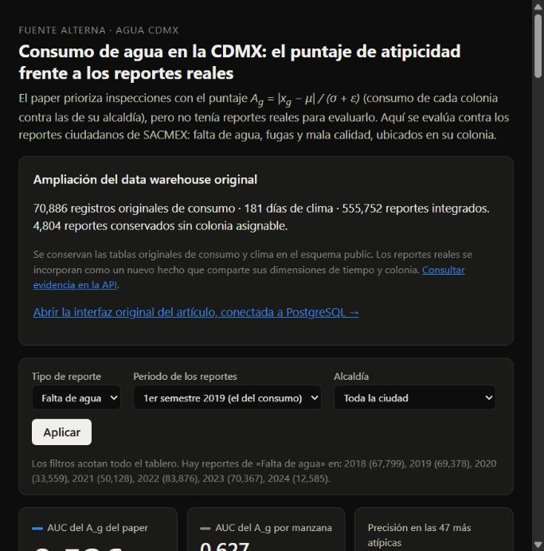
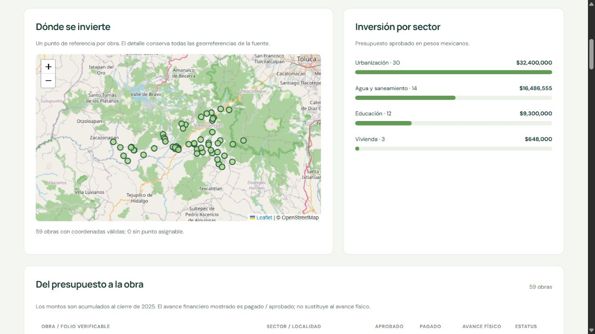
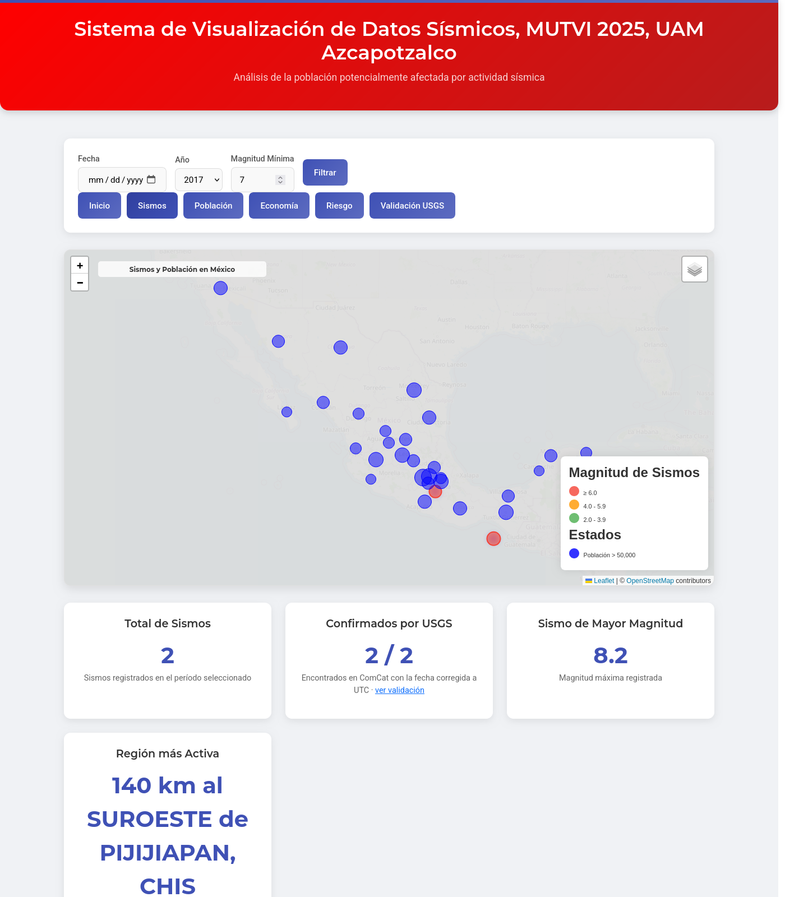
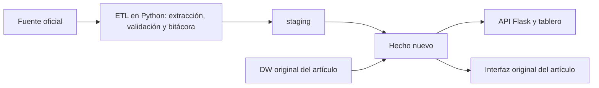

# Fuentes alternas para tres data warehouses

Integración de datos oficiales y citables en los data warehouses de tres artículos académicos: un catálogo sísmico, el consumo de agua de la Ciudad de México y la obra pública municipal. Cada sistema conserva el modelo original del artículo y le agrega un hecho nuevo, cargado desde una fuente pública. La carga se hace con un ETL reproducible y verificable de la fuente a la API.

Práctica de Bases de Datos · Escuela Superior de Cómputo (ESCOM), IPN.

| Agua CDMX | Obras de Temascaltepec | Sismos |
|---|---|---|
|  |  |  |

## Los tres sistemas

La ampliación demográfica de sismos incorpora población oficial de Estados Unidos y Canadá para 2020–2025
(396 observaciones). Disponible en http://127.0.0.1:8091/demografia/ y desde el menú original.
Fuentes, ETL, tablas y alcance se explican en [el README de sismos](sismos-usgs/README.md#ampliación-demográfica-estados-unidos-y-canadá).

| Sistema | Artículo y modelo original | Fuente alterna | Qué agrega |
|---|---|---|---|
| [**Sismos**](sismos-usgs/README.md) | *Cuando México tiembla*: catálogo del Servicio Sismológico Nacional (SSN) | [USGS ANSS ComCat](https://doi.org/10.5066/F7MS3QZH), API FDSN | `public.fact_cruce_usgs`: cada sismo del SSN cruzado con una red independiente |
| [**Agua CDMX**](agua-reportes-sacmex/README.md) | Consumo de agua por colonia, primer semestre de 2019 | [SACMEX, *Reportes de agua*](https://datos.cdmx.gob.mx/dataset/reportes-de-agua) | `public.fact_reporte_agua`: 555,752 reportes ciudadanos para validar la detección de colonias atípicas |
| [**Obra pública**](obra-publica-srft/README.md) | DW de obra municipal probado con datos sintéticos | [SHCP, *Gasto federalizado*](https://www.transparenciapresupuestaria.gob.mx/Datos-Abiertos), informe definitivo 2025 | `warehouse.fact_srft` y 59 expedientes reales de Temascaltepec |

En los tres casos se sigue el mismo patrón:



## Hallazgos principales

- **Sismos:** el DW del artículo une la fecha local del SSN con la hora UTC, así que 74,927 sismos (23.7 %) quedan con un día de menos. Por ejemplo, el M8.2 de Tehuantepec aparece el 7 de septiembre de 2017, pero ocurrió el 8. Con la fecha corregida, la proporción de sismos M ≥ 4.5 que confirma el USGS pasa de 64.2 % a 83.5 %.
- **Agua:** el artículo prioriza inspecciones con un puntaje de atipicidad del consumo, pero no tenía reportes reales con qué evaluarlo. El tablero lo contrasta con los reportes de *falta de agua* del mismo semestre de 2019.
- **Obras:** el sistema se había probado solo con datos sintéticos. Ahora contiene las 59 obras con recursos federales de Temascaltepec en 2025: $58,834,555.00 aprobados y $58,803,710.52 pagados.

## Documentación de la ampliación demográfica de EE. UU. y Canadá

**Actualización del 26 de octubre:** ya se amplió también el catálogo sísmico y su mapa. Abrir
http://localhost:8091/norteamerica/ o **Sismos de Norteamérica** desde el menú original de sismos.
Se cargaron 14,041 eventos reales de [USGS ComCat (DOI 10.5066/F7MS3QZH)](https://doi.org/10.5066/F7MS3QZH),
2020–2025 y magnitud ≥ 3.5. Los límites gubernamentales permiten asignar 2,455 a EE. UU. y 245 a Canadá;
11,341 quedan sin asignación y se consultan en una cobertura separada. Cada evento asignado se relaciona con la
población de su región y año. No se calculan afectados ni impactos económicos.

La [documentación de Norteamérica](sismos-usgs/README.md#ampliación-sísmica-a-norteamérica-26-de-octubre-de-2026)
explica límites, CSV, parámetros de descarga, transformaciones, tablas, mapa y comandos. Scripts: las fuentes
[`fuentes/usgs_norteamerica.py`](sismos-usgs/app/fuentes/usgs_norteamerica.py) y [`fuentes/limites.py`](sismos-usgs/app/fuentes/limites.py),
la carga [`cargas/norteamerica.py`](sismos-usgs/app/cargas/norteamerica.py), la ruta [`rutas/norteamerica.py`](sismos-usgs/app/rutas/norteamerica.py)
y [`verificacion/norteamerica.py`](sismos-usgs/app/verificacion/norteamerica.py). Archivos oficiales y hashes en
[`datos/usgs/norteamerica/procedencia.json`](sismos-usgs/datos/usgs/norteamerica/procedencia.json) y
[`datos/limites/procedencia.json`](sismos-usgs/datos/limites/procedencia.json).
Evidencia: [`63 comprobaciones aprobadas`](evidencia/norteamerica.json).

Esta sección documenta el trabajo local del **25 de octubre de 2026**. El objetivo es ampliar el contexto
demográfico del sistema de sismos con población oficial consultable. La integración territorial y el mapa se
añadieron el 26 de octubre, como se describe arriba.

### Fuentes reales, identificadores y archivos descargados

| País | Institución y conjunto | Identificador verificable | Descarga oficial | Copia en este repositorio |
|---|---|---|---|---|
| Estados Unidos | U.S. Census Bureau, *State Population Totals and Components of Change: 2020–2025*, Vintage 2025 | `NST-EST2025-ALLDATA`. No se verificó un DOI para este archivo | [CSV oficial](https://www2.census.gov/programs-surveys/popest/datasets/2020-2025/state/totals/NST-EST2025-ALLDATA.csv) | [`NST-EST2025-ALLDATA.csv`](sismos-usgs/datos/demografia/us/NST-EST2025-ALLDATA.csv) |
| Canadá | Statistics Canada, *Population estimates on July 1, by age and gender* | Tabla `17-10-0005-01`; [DOI `10.25318/1710000501-eng`](https://doi.org/10.25318/1710000501-eng) | [ZIP oficial con CSV y metadatos](https://www150.statcan.gc.ca/n1/tbl/csv/17100005-eng.zip) | [`17100005-eng.zip`](sismos-usgs/datos/demografia/ca/17100005-eng.zip) |

Páginas para comprobar el título, alcance, metodología y opciones de descarga:

- [Census Bureau: población estatal 2020–2025](https://www.census.gov/data/datasets/time-series/demo/popest/2020s-state-total.html).
- [Statistics Canada: tabla 17-10-0005-01](https://www150.statcan.gc.ca/t1/tbl1/en/tv.action?pid=1710000501).

Un ISSN identifica una publicación periódica; no es el identificador de estos archivos de datos. Para esta ampliación
se cita el DOI canadiense y la institución, tabla, versión y URL oficiales estadounidenses. Si la rúbrica exige
**DOI para cada conjunto**, la fuente estadounidense no tiene ese requisito verificado. No debe presentarse el DOI
del artículo de sismos o el de USGS como si identificara la población de Census Bureau.

### Cómo buscamos y seleccionamos las fuentes

Se hicieron búsquedas acotadas a los dominios institucionales `statcan.gc.ca` y `census.gov`, con términos como
`population estimates age gender provinces territories csv` y `population estimates state age sex datasets csv`.
Se revisaron las páginas oficiales y se siguieron sus enlaces de descarga, no tablas de blogs o cifras generadas.
La selección final para EE. UU. fue la tabla de **totales estatales**, en vez del archivo detallado de edad y sexo.
Para Canadá se seleccionó la categoría total dentro de la tabla demográfica.

Se eligieron porque ofrecen archivos descargables, cobertura regional, años en común y una medida comparable:
**población total residente estimada al 1 de julio, todas las edades, de 2020 a 2025**. Son estimaciones oficiales
revisables, no seis censos ni un conteo de personas afectadas. La fecha de descarga no es la fecha de referencia.

### Cómo se hace el ETL y de dónde sale cada campo

Hay un script por fuente, [`fuentes/census_us.py`](sismos-usgs/app/fuentes/census_us.py) y
[`fuentes/statcan_ca.py`](sismos-usgs/app/fuentes/statcan_ca.py) (pasos 1–3), y la carga
[`cargas/demografia.py`](sismos-usgs/app/cargas/demografia.py) (pasos 4–6). Son scripts Python, no archivos `.exe`. Usa las dependencias ya existentes del proyecto.

1. **Extraer:** descarga el CSV de Census y el ZIP de Statistics Canada. Dentro del ZIP lee `17100005.csv`.
2. **Transformar EE. UU.:** selecciona `SUMLEV=010` (total nacional) y `040` (estados/DC), excluye Puerto Rico y
   agregados censales. Convierte las columnas `POPESTIMATE2020` a `POPESTIMATE2025` en filas por año.
3. **Transformar Canadá:** selecciona años 2020–2025, `Gender=Total - gender`, `Age group=All ages`,
   `UOM=Persons` y `SCALAR_FACTOR=units`. Conserva `DGUID` y el estado de publicación `STATUS`.
4. **Validar:** comprueba población positiva, claves únicas, 51 regiones de EE. UU. y 13 de Canadá por año,
   y que su suma coincida exactamente con el total oficial de cada país. No rellena cifras ausentes con ceros.
5. **Guardar extracto:** escribe [`poblacion_2020_2025.csv`](sismos-usgs/datos/demografia/poblacion_2020_2025.csv)
   y [`procedencia.json`](sismos-usgs/datos/demografia/procedencia.json), con URLs, filtros, fecha, tamaños y SHA-256.
6. **Cargar:** crea las tablas nuevas en la misma base `sismos_dw` y usa `INSERT … ON CONFLICT DO UPDATE`.
   Repetir la carga actualiza la misma clave país/región/fecha y no duplica registros. El extracto conservado se
   reutiliza verificando su hash; actualizar desde Internet requiere `--descargar`.

| Campo del extracto | Origen o transformación |
|---|---|
| `pais` | Etiqueta `US` o `CA` asignada según el archivo institucional de origen |
| `codigo` | `STATE` en Census; últimos dos caracteres de `DGUID` para provincias/territorios canadienses; `00` para el total nacional |
| `nombre` | `NAME` estadounidense o `GEO` canadiense |
| `nivel` | `pais` para el total nacional; `region` para estados/DC o provincias/territorios |
| `anio` | Sufijo de `POPESTIMATE…` o `REF_DATE`; se conserva como referencia el 1 de julio |
| `poblacion` | Valor de `POPESTIMATE…` o `VALUE`, convertido a entero, sin estimarlo nosotros |
| `identificador_origen` | `STATE` o `DGUID` original |
| `estado_origen` | `STATUS` canadiense; vacío en el extracto de Census, que no usa ese campo |

Resultado: **396 observaciones**, no 396 personas ni 396 regiones. Son 66 geografías × 6 años:
384 observaciones regionales y 12 totales nacionales. EE. UU. aporta 312 y Canadá 84.

### Tablas, backend, frontend y ejecutables

| Componente | Ubicación y función |
|---|---|
| Fuentes | `public.dim_fuente_demografia`: institución, título, URL, DOI cuando existe y hash original |
| Regiones | `public.dim_region_demografia`: país, código, nombre, nivel e identificador original |
| Hechos | `public.fact_poblacion_demografia`: población por país, código y fecha, con FK a la región |
| Vista | `public.v_poblacion_demografia`: relaciona fuentes, regiones y población |
| Registro de carga | `etl.demografia_carga`: manifiesto, hash, fecha de carga y cantidad por extracto distinto |
| ETL | [`fuentes/census_us.py`](sismos-usgs/app/fuentes/census_us.py), [`fuentes/statcan_ca.py`](sismos-usgs/app/fuentes/statcan_ca.py) y [`cargas/demografia.py`](sismos-usgs/app/cargas/demografia.py), invocados desde [`etl.py`](sismos-usgs/app/etl.py) |
| Backend | [`rutas/demografia.py`](sismos-usgs/app/rutas/demografia.py), registrado en [`web.py`](sismos-usgs/app/web.py) |
| API | `http://localhost:8091/api/demografia?pais=US&anio=2025`; acepta `US`/`CA` y 2020–2025 |
| Frontend | [`demografia.html`](sismos-usgs/app/templates/demografia.html); página `http://localhost:8091/demografia/` |
| Menú original | [`vista.html`](sismos-usgs/original/src/vista.html) enlaza a [`demografia.php`](sismos-usgs/original/src/demografia.php), que redirige al tablero configurado |
| Verificador | [`verificacion/demografia.py`](sismos-usgs/app/verificacion/demografia.py) |
| Arranque general | [`iniciar-docker.ps1`](iniciar-docker.ps1), ejecutado desde la raíz con Docker Desktop abierto |

El frontend consulta datos de PostgreSQL a través del servidor; las poblaciones no están escritas a mano en la plantilla.
La documentación técnica ampliada, relaciones y lista completa de cambios están en [el README de sismos](sismos-usgs/README.md#registro-de-implementación-del-25-de-octubre-de-2026).

### Cómo ejecutarlo y demostrarlo

Comandos **desde la raíz del repositorio, en PowerShell**. Con Docker Desktop abierto, arranque general:

```powershell
powershell -NoProfile -ExecutionPolicy Bypass -File .\iniciar-docker.ps1
```

Si la base de sismos ya está levantada, construir la imagen y cargar únicamente demografía:

```powershell
docker compose -f sismos-usgs/compose.yml -f sismos-usgs/compose.windows.yml build web
docker compose -f sismos-usgs/compose.yml -f sismos-usgs/compose.windows.yml run --rm --no-deps etl python -m cargas.demografia
docker compose -f sismos-usgs/compose.yml -f sismos-usgs/compose.windows.yml up -d --no-deps web
```

Actualizar expresamente desde las fuentes oficiales (puede cambiar la versión de las estimaciones):

```powershell
docker compose -f sismos-usgs/compose.yml -f sismos-usgs/compose.windows.yml run --rm --no-deps etl python -m cargas.demografia --descargar
```

Verificar archivos, base, API y páginas:

```powershell
docker compose -f sismos-usgs/compose.yml -f sismos-usgs/compose.windows.yml run --rm --no-deps -e URL_SISMOS=http://web:8000 etl python -m verificacion.demografia
```

Mostrar la estructura y consultar datos del warehouse:

```powershell
docker exec fa-sismos-db psql -U sismos -d sismos_dw -c "\d public.fact_poblacion_demografia"
docker exec fa-sismos-db psql -U sismos -d sismos_dw -c "SELECT pais,nombre,anio,poblacion FROM public.v_poblacion_demografia WHERE nivel='region' AND anio=2025 ORDER BY pais,nombre;"
```

### Cómo comprobamos que no son cifras inventadas

- Se conservan los dos originales descargados y su extracto. El manifiesto permite rastrear la URL y los filtros.
- Al documentar esta ampliación se volvieron a descargar ambos originales desde sus URLs oficiales: sus SHA-256
  coincidieron exactamente con los de los archivos usados. El hash prueba identidad de bytes, no que una estimación
  oficial sea una medición perfecta.
- [`evidencia/demografia.json`](evidencia/demografia.json) registra **22 comprobaciones aprobadas**, incluidas
  comparación de las 396 observaciones con la base, hashes y reconciliación de los 12 totales país/año leídos de las fuentes.
- Se repitió la carga sin aumentar las 396 observaciones. La captura está en [`evidencia/demografia-us.png`](evidencia/demografia-us.png).
- Los totales nacionales 2025 de las versiones usadas son 341,784,857 personas para EE. UU. y 41,608,982 para Canadá.
  No sumar totales nacionales junto con regiones, ni sumar poblaciones de distintos años como personas diferentes.

### Qué aporta y qué falta

Antes no había una serie nueva documentada de población de EE. UU. y Canadá en esta ampliación. Ahora se pueden
comparar años y regiones, consultar el porcentaje de población de cada región dentro de su país y rastrear cada dato
a una fuente oficial. Se añaden tablas de hechos/dimensiones, ETL, registro de carga, API, vista y verificaciones.

Para el trabajo conjunto, proporciona contexto demográfico. **La ampliación del 26 de octubre ya relaciona eventos
USGS con regiones gubernamentales y población del mismo año, y los muestra en el mapa.**
No se calcularon población expuesta, afectados, daños económicos, riesgo validado ni tasas
de sismos por habitante. No se modificaron las cifras económicas originales ni agua ni obras en este trabajo.
La búsqueda inicial consideró edad/sexo, pero la implementación actual solo incorpora población total; no afirmar
que ya existe ese desglose ni una expansión a Centroamérica o Sudamérica.

### Explicación para el jefe o profesor

«Mi parte fue integrar datos demográficos oficiales de Estados Unidos y Canadá al sistema de sismos. Localizamos
las fuentes en Census Bureau y Statistics Canada; Canadá tiene DOI y Estados Unidos tiene un archivo y versión
identificados en su portal oficial. Descargamos los originales, seleccionamos población total de 2020 a 2025 y
aplicamos un ETL para organizarla por región y año. Validamos los totales y cargamos 396 observaciones en PostgreSQL
sin duplicarlas al repetir la carga. La nueva pantalla consulta esa base y muestra la fuente. Esto amplía el contexto
demográfico, ahora relacionado con los eventos USGS asignados a esas regiones en el mapa de Norteamérica. No presentamos población
regional como personas afectadas por un terremoto.»

Actualización para la explicación del 26 de octubre: «Después integramos también eventos oficiales de USGS para
2020–2025, los asignamos a estados y provincias mediante límites gubernamentales y conectamos el mapa principal.
Cada evento asignado muestra su población regional como contexto. Los eventos sin una región asignable se conservan
y se consultan por separado; no inventamos su país ni su impacto.»

Para revisarlo: abrir la página, cambiar país y año, seguir el enlace oficial de la fuente, enseñar el original conservado,
consultar las tablas y ejecutar el verificador. Este texto documenta trabajo local realizado con apoyo de Codex;
no equivale a una publicación en GitHub. No se hizo commit ni push de esta ampliación al escribir esta sección.

## Inicio rápido

**Requisitos:**
- Docker con Compose (Docker Desktop en Windows y macOS).
- Unos 5 GB libres: imágenes de Docker y bases cargadas.
- Internet en la primera construcción.
- Libres los puertos 5441–5443 y 8091–8094.

**Linux o macOS:**

```sh
./iniciar.sh              # construye, carga los datos y comprueba las páginas
./iniciar.sh --recargar   # repite los ETL desde los archivos guardados, sin duplicar hechos
```

**Windows (PowerShell):**

```powershell
powershell -NoProfile -ExecutionPolicy Bypass -File .\iniciar-docker.ps1
powershell -NoProfile -ExecutionPolicy Bypass -File .\iniciar-docker.ps1 -Recargar
```

`-ExecutionPolicy Bypass` solo aplica a esa ejecución y no cambia la configuración del equipo. La primera carga tarda unos minutos. Las siguientes reutilizan los datos ya cargados.

Cuando el script termina, estas páginas están disponibles:

| Página | Dirección |
|---|---|
| Sismos: tablero de validación SSN ↔ USGS | http://127.0.0.1:8091 |
| Sismos: interfaz original del artículo (PHP) | http://127.0.0.1:8094 |
| Agua: tablero de reportes y consumo | http://127.0.0.1:8092 |
| Agua: interfaz original del artículo | http://127.0.0.1:8092/sistema/ |
| Agua: grafo RDF con consultas SPARQL | http://127.0.0.1:8092/sistema/grafo.html |
| Obras: tablero de datos oficiales | http://127.0.0.1:8093 |
| Obras: expedientes administrativos | http://127.0.0.1:8093/expedientes/ |

Cada sistema también se puede levantar por separado con `docker compose up -d --build` desde su carpeta. Las contraseñas son solo de desarrollo local y están en cada `compose.yml`.

## Verificación

`verificar.py` (42 pruebas) y `verificar_extensiones.py` (20 pruebas) comparan la fuente, la base de datos y la API. Revisan conteos y montos, enlaces a las dimensiones originales, recargas sin duplicados, el grafo RDF y las interfaces originales. Guardan el resultado y los SHA-256 de los archivos fuente en [`evidencia/`](evidencia/).

Necesitan las dependencias de `requirements-local.txt` instaladas en `.runtime/`, que está excluida de Git y depende de la versión de Python:

```sh
# Linux o macOS
uv pip install --python python3 --target .runtime -r requirements-local.txt
# o, sin uv:
python3 -m venv /tmp/fa-venv && /tmp/fa-venv/bin/pip install --target .runtime -r requirements-local.txt

python3 verificar.py && python3 verificar_extensiones.py
```

En Windows, `iniciar.ps1` instala las dependencias en `.runtime/` la primera vez; después se ejecutan `python .\verificar.py` y `python .\verificar_extensiones.py`. Ese mismo script ofrece una alternativa con Python local, que usa Docker solo para las bases: `-SoloDatos` carga las bases sin iniciar los servidores web.

## Estructura del repositorio

```text
.
├── sismos-usgs/            Sistema 1: catálogo SSN cruzado con USGS ComCat
├── agua-reportes-sacmex/   Sistema 2: consumo de agua y reportes ciudadanos
├── obra-publica-srft/      Sistema 3: obras de Temascaltepec (SHCP/SRFT)
│   ├── app/                etl.py (orquestador), fuentes/ (un script por fuente), cargas/, API Flask
│   ├── db/                 Esquema y extensiones SQL (se cargan al crear el volumen)
│   ├── datos/              Extractos oficiales, una carpeta por grupo; original/ = datos del programa original
│   ├── original/           Componentes del proyecto original con su licencia
│   └── compose.yml
├── evidencia/              Resultados de verificación, hashes y capturas
├── iniciar.sh              Arranque en Linux o macOS
├── iniciar-docker.ps1      Arranque en Windows, todo en Docker
├── iniciar.ps1             Arranque en Windows con Python local
├── verificar.py            Pruebas fuente → base → API
├── verificar_extensiones.py  Pruebas de expedientes y RDF/SPARQL
├── ENTREGA.md              Guion de demostración y consultas esperadas
└── PROCEDENCIA_ORIGINALES.md  Versiones, autoría y cambios a los originales
```

## Fuentes de datos

- U.S. Geological Survey. (2017). *Advanced National Seismic System (ANSS) Comprehensive Catalog* [Conjunto de datos]. https://doi.org/10.5066/F7MS3QZH. Dominio público.
- Sistema de Aguas de la Ciudad de México. (s. f.). *Consumo de agua* [Conjunto de datos]. Portal de Datos Abiertos CDMX. https://datos.cdmx.gob.mx/dataset/consumo-agua. CC BY 4.0.
- Sistema de Aguas de la Ciudad de México. (s. f.). *Reportes de agua* [Conjunto de datos]. Portal de Datos Abiertos CDMX. https://datos.cdmx.gob.mx/dataset/reportes-de-agua. CC BY 4.0.
- Secretaría de Hacienda y Crédito Público. (s. f.). *Gasto federalizado: Destino del gasto, informe definitivo 2025* [Conjunto de datos]. Portal de Transparencia Presupuestaria. https://www.transparenciapresupuestaria.gob.mx/Datos-Abiertos

Fecha de consulta: 23 de octubre de 2026. Las cifras de este README se comprobaron ese día.

Los archivos usados se conservan en la carpeta `datos/` de cada sistema, con su URL de origen, filtros y SHA-256. El ZIP nacional de la SHCP es la única excepción: se excluye de Git, y su manifiesto queda en `obra-publica-srft/datos/procedencia.json`.

## Limitaciones

- **Sismos:**
  - Un par confirma que dos redes registraron el mismo evento, no la exactitud de la magnitud del SSN.
  - ComCat también republica soluciones del propio SSN (red `UNM`). Por eso la validación independiente solo cuenta las soluciones calculadas por otras redes.
- **Agua:**
  - El consumo solo existe para el primer semestre de 2019. Compararlo con reportes de otros años es exploratorio, no causal.
  - 4,804 reportes se conservan sin colonia porque no se pueden ubicar con las reglas disponibles.
  - La asignación por manzana cercana (menos de 1 km) es aproximada.
- **Obras:**
  - La SHCP solo cubre obras con recursos federales, no toda la obra municipal.
  - El estatus y el avance físico son lo que declara la fuente, no inspecciones de campo.
  - Los datos que la fuente no publica, como supervisores, actas o firmas, quedan nulos; no se inventan.
- **General:** los mapas base y algunas bibliotecas de las interfaces se cargan desde Internet. Los datos y las consultas son locales.

Cada README de sistema detalla sus límites. [`ENTREGA.md`](ENTREGA.md) resume qué se puede afirmar y qué no al presentar los resultados.

## Proyectos originales y créditos

Este repositorio amplía tres proyectos publicados con licencia MIT. Sus componentes se conservan en las carpetas `original/`, con su licencia y autoría. Las versiones exactas y los cambios locales están en [`PROCEDENCIA_ORIGINALES.md`](PROCEDENCIA_ORIGINALES.md).

- Villa Vargas, J. M., Hurtado Avilés, G., y Climent Hernández, J. A. (2026). Cuando México tiembla: la historia contada por los datos. *AZCATL Revista de Divulgación de la Ciencia, la Ingeniería y la Innovación, 4*(6), 28–33. https://doi.org/10.24275/AZC2026E1004. Código: [gabrielhuav/Seismic-Data-Visualization-System](https://github.com/gabrielhuav/Seismic-Data-Visualization-System).
- Velázquez Arrieta, E. U., Pulido Morales, O. F., García López, E., Hernández Martínez, C. A., y Hurtado Avilés, G. (en prensa). Territorial information retrieval from heterogeneous open data through the construction of a data warehouse for water management in Mexico City. En *Advances in Computer Science Applications and Research*. Springer. Código: [gabrielhuav/data_warehouse_cdmx](https://github.com/gabrielhuav/data_warehouse_cdmx) y [gabrielhuav/Data_Warehouse_static](https://github.com/gabrielhuav/Data_Warehouse_static).
- González Casiano, U., Maldonado Mejía, M. T., y Hurtado Avilés, G. (2026). A dimensional data warehouse for geospatial monitoring of municipal public works, with an evolution path toward a lakehouse architecture. En *Advances in Computer Science Applications and Research*. Springer. Código: [gabrielhuav/PublicMunicipalWorks_DWH](https://github.com/gabrielhuav/PublicMunicipalWorks_DWH).

## Licencia

El código de este repositorio se distribuye con licencia [MIT](LICENSE). Los componentes de las carpetas `original/` conservan la licencia MIT y la autoría de sus proyectos de origen. Los datos conservan la licencia de su fuente: dominio público (USGS), CC BY 4.0 (Datos Abiertos CDMX) y datos abiertos de la SHCP.
