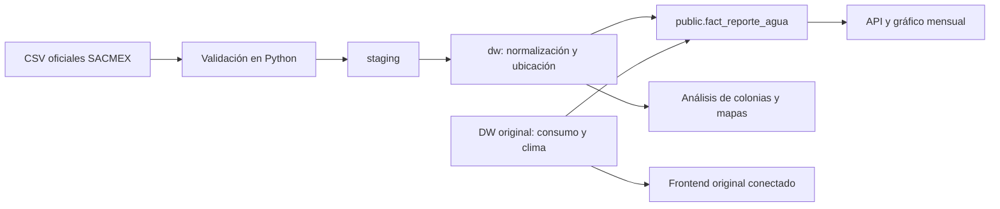

# Agua CDMX: reportes ciudadanos en el DW original

## Ejecutar

En Windows, usar `iniciar-docker.ps1` desde la raíz; en Linux o macOS, `./iniciar.sh`. Abre http://127.0.0.1:8092.

Alternativa completamente en Docker, desde esta carpeta:

```sh
docker compose up -d --build
docker compose logs -f etl
```

La web espera que el ETL termine correctamente. El esquema `dw` se inicializa al crear el volumen; el esquema original `public` se inicializa una sola vez desde `original/ddl/0_schema.sql`. Las versiones originales se documentan en `../PROCEDENCIA_ORIGINALES.md`.

## Recorrido de los datos



Se conservan los hechos y sus claves originales. Los nuevos reportes comparten `public.dim_tiempo` y `public.dim_ubicacion`. Las equivalencias no suponen que los identificadores de dos esquemas coinciden: se construyen a partir de nombres normalizados. Los reportes sin colonia identificable mantienen ubicación nula.

La asignación geográfica usa coincidencia de nombres y, en su defecto, una manzana próxima a menos de 1 km. Es una aproximación; no utiliza polígonos administrativos. Las variantes de nombres se unifican en el área analítica, pero la dimensión original permanece intacta.

## Fuentes

Sistema de Aguas de la Ciudad de México. (s. f.). *Consumo de agua* [Conjunto de datos]. Portal de Datos Abiertos CDMX. https://datos.cdmx.gob.mx/dataset/consumo-agua

Sistema de Aguas de la Ciudad de México. (s. f.). *Reportes de agua* [Conjunto de datos]. Portal de Datos Abiertos CDMX. https://datos.cdmx.gob.mx/dataset/reportes-de-agua

Los identificadores de los recursos y sus URL se encuentran en `app/etl.py`, `etl.recurso` y la sección Fuentes de la página. Fecha de consulta: 23 de octubre de 2026. El clima de 2019 es la copia del CSV Open-Meteo distribuida con el proyecto original.

## Comprobaciones y límites

Se preservan 70,886 consumos y 181 días de clima; se integran 555,752 reportes. No se asigna colonia a 4,804 reportes que no se pueden ubicar con las reglas disponibles. Las métricas de contraste entre consumo y reportes se interpretan como análisis exploratorio. El periodo simultáneo es enero–junio de 2019; el resto de años no aporta consumo nuevo.

`/api/original` expone la integración; `/sistema/consumo.json` consulta el DW original en cada petición. El frontend original está disponible en `/sistema/`. El grafo actualizado está en `/sistema/grafo.html`: el ETL incorpora todos los reportes a RDF, agregados por colonia, año, tipo, clasificación y recurso. Las nuevas consultas muestran reportes por año, tipo, colonia y los que no tienen ubicación asignable. Consumo y reportes comparten los identificadores territoriales del DW vivo.

`datos/grafo_integrado.ttl` se excluye de Git y se regenera automáticamente; se sirve comprimido al navegador. Sus metadatos están en `/api/grafo` y `datos/grafo_integrado.json`. El mapeo adicional está en `original/frontend/mapping-reportes.r2rml.ttl`; el materializador Python adapta el exportador original y aplica la vista SQL `public.v_rdf_reportes`.

El grano anual de los reportes RDF es explícito: compararlos con consumo del primer semestre no representa periodos idénticos. El tablero relacional sí permite seleccionar enero–junio de 2019.

El explorador ejecuta las consultas SELECT y ASK mediante `/api/grafo/sparql`, sobre una copia en memoria del RDF local que se invalida al regenerar el archivo. No consulta servicios remotos; SERVICE y FROM se rechazan antes de ejecutar. La primera consulta prepara el grafo y puede tardar más que las siguientes.
