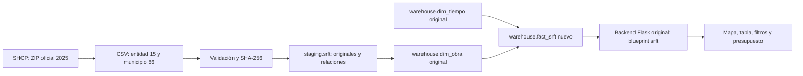

# Obras reales de Temascaltepec: extensión SHCP/SRFT

## Ejecutar

En Windows, usar `iniciar-docker.ps1` desde la raíz; en Linux o macOS, `./iniciar.sh`. Abre http://127.0.0.1:8093.

Alternativa completamente en Docker, desde esta carpeta:

```sh
docker compose up -d --build
docker compose logs -f etl
```

La base se inicializa con los SQL originales de `original/db` y después con `db/04_srft.sql`. Los datos nacionales se extraen una vez; los CSV filtrados y su manifiesto vienen incluidos. El ETL puede recargar desde ellos sin descargar otra vez el ZIP. Para forzar una nueva descarga se usa `FORZAR_DESCARGA=1` en el entorno del proceso ETL.

## Integración



Se comparten dos dimensiones originales; no se reemplaza la arquitectura con una base paralela. El prefijo técnico `SRFT:` distingue la clave de origen de una clave operacional local. Se conserva el folio oficial completo.

Se incorporan los expedientes a las tablas originales `public.obra`, `public.presupuesto_obra`, `public.region`, `public.constructora` y `public.financia`. La migración `05_expedientes.sql` permite campos desconocidos en importaciones identificadas, conservando requisitos para los registros manuales. Las claves técnicas `SRFT:` son identificadores locales, no números oficiales inventados.

La página `/expedientes/` muestra los contratos, los números de expediente y contrato publicados, presupuesto, financiamiento y faltantes. `/api/srft/expediente/<folio>` sirve esos datos; la API pública original también devuelve las 59 obras.

Los supervisores, proyectistas, actas y firmas no publicados permanecen nulos o sin registros. No se confunde el RFC del convocante con el del contratista. Si una obra tiene varios contratistas, se conservan todos los contratos sin atribuir uno arbitrariamente como contratista único. El informe anual de SHCP se almacena separado de los informes mensuales firmados por supervisores. La auditoría registra la importación actual con el tipo `IMPORTACION_SHCP`, no un evento histórico municipal.

No se carga el generador sintético original ni se crean cuentas de demostración para acceder: los expedientes importados son consultables en modo público de lectura. Los módulos internos que requieren iniciar sesión mantienen su autenticación.

## Fuente y limpieza

Secretaría de Hacienda y Crédito Público. (s. f.). *Gasto federalizado: Destino del gasto, informe definitivo 2025* [Conjunto de datos]. Portal de Transparencia Presupuestaria. https://www.transparenciapresupuestaria.gob.mx/Datos-Abiertos

CSV dentro del [ZIP oficial](https://www.transparenciapresupuestaria.gob.mx/work/models/PTP/DatosAbiertos/Entidades_Federativas/2025/ef2025.zip). Consultado el 23 de octubre de 2026. La URL figura en el catálogo oficial guardado como `datos/catalogo_shcp.json`.

La descarga nacional contiene 91,062 proyectos. El filtro entidad 15, municipio 86 produce 59. Se decodifica Windows-1252 y se guardan extractos UTF-8. Se validan folios únicos, fechas, números finitos y no negativos, municipio y periodo. Los rechazos se registran en `datos/rechazados.json` y la bitácora. La carga comprobada tuvo cero proyectos rechazados.

Las relaciones se agrupan por folio antes de obtener los totales: unir directamente todos los contratos, metas y coordenadas duplicaría montos. Para el mapa se usa un punto válido por obra y se conservan todos en el detalle. El porcentaje físico se calcula solo para una meta con denominador positivo; metas de distintas unidades no se suman.

El periodo **5** significa informe definitivo. La fecha de referencia del hecho es el cierre del ejercicio, **31 de diciembre de 2025**. El gasto pagado es acumulado, no gasto de un quinto trimestre. El presupuesto aprobado, la recaudación y los momentos de gasto permanecen diferenciados.

## Resultado comprobado

59 obras en 38 localidades, todas con un punto válido; $58,834,555.00 aprobados y $58,803,710.52 pagados. El cierre reporta las obras terminadas; esto no es una inspección física. El universo corresponde a recursos federales reportados, no a todas las obras municipales.

Los hashes y la URL de descarga están en `datos/procedencia.json`. El detalle de cada folio está en `/api/srft/proyecto/<folio>`. El manifiesto se valida antes de usar un extracto local.
