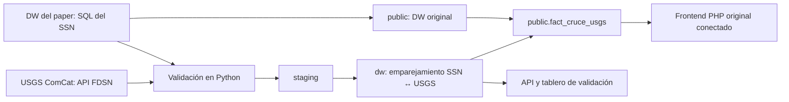

# Sismos: validación del catálogo SSN con USGS ComCat en el DW original

## Ejecutar

En Windows, usar `iniciar-docker.ps1` desde la raíz; en Linux o macOS, `./iniciar.sh`. Abre http://127.0.0.1:8091 (tablero de validación) y http://127.0.0.1:8094 (interfaz original del artículo).

Alternativa completamente en Docker, desde esta carpeta:

```sh
docker compose up -d --build
docker compose logs -f etl
```

La web y la interfaz original esperan a que el ETL termine correctamente. Los esquemas `etl`, `staging` y `dw` se inicializan al crear el volumen. El esquema original `public` se carga una sola vez con los scripts SQL del proyecto original. Para volver a cargar todo se usa `FORZAR_ETL=1 docker compose up etl`. Las versiones originales están documentadas en `../PROCEDENCIA_ORIGINALES.md`.

## Recorrido de los datos



El DW original se conserva con sus claves: `dim_sismos`, `dim_tiempo`, `dim_zonas`, `dim_economia` y `fact_impacto_sismos_imputed`. El nuevo hecho `public.fact_cruce_usgs` se enlaza con claves foráneas a `public.dim_sismos` y a `public.dim_tiempo`. En el modelo original cada sismo tiene su propio registro de tiempo (`id_tiempo = id_sismo`). `public.dim_fuente_sismo` registra las dos fuentes con su cita y su DOI.

El emparejamiento se calcula en `dw` (función `dw.fn_emparejar`) y se repite para dos variantes de fecha:

- `corregida`: el instante UTC reconstruido. Es la que se usa en el análisis.
- `dw_original`: la marca de tiempo tal como viene en el DW del paper. Se conserva como diagnóstico.

Un par requiere cercanía en tiempo (±30 s), en distancia (100 km) y en magnitud (|ΔM| ≤ 1). Antes de 1964 las tolerancias son ±120 s y 250 km, porque los catálogos históricos redondean. La asignación es uno a uno.

Los sismos del USGS sin contraparte en el SSN quedan en `dw`. No se añaden filas inventadas a `public.dim_sismos`.

## Interfaz original conectada

El servicio `original` sirve el frontend PHP del artículo, con PHP 8.2 y Apache, sobre la misma base. Los cambios están marcados con el comentario `fuentes-alternas`:

- `config_local.php` lee las credenciales del entorno. Las páginas originales tenían credenciales fijas y distintas entre sí, incluso `localhost` en `datos_sismicos.php`.
- Los enlaces de navegación apuntaban a páginas que no existen en el repositorio (`mexico.php`, `poblacion.php`, `riesgo.php` y `resultado_final.php`). Ahora llevan a `vista.html`, `std2.php` y `std.php`, y el último se retiró.
- `sismos.php` y `datos_sismicos.php` muestran en cada sismo si ComCat lo confirma, con su magnitud y la distancia entre epicentros. `sismos.php` también suma los confirmados del mapa.
- `index.php` redirige al menú `vista.html`, y `validacion.php` abre el tablero de validación.
- Los mapas económicos se empatan por nombre de entidad. `std3.php` buscaba la clave INEGI en `dim_economia.entidad`, que no la contiene (Aguascalientes = 5797), y quedaba vacío; `aeconomica.php` comparaba nombres sin acentos y dejaba fuera 9 estados, entre ellos la Ciudad de México. Además, `std3.php` colorea por cuantiles del indicador elegido (cuatro entidades por color), porque su escala fija de 10,000 a 1,000,000 dejaba casi todos los estados en el mismo rojo, `aeconomica.php` usa quintiles en lugar de cinco tramos iguales, que con la Ciudad de México muy por encima dejaban casi todo en el primer color, y formatea bien los números de la leyenda.
- `sismos.php` y `sismo.php` usaban el mapa base de CARTO, que ahora exige una clave de API: en lugar del mapa devuelve teselas con la leyenda «API KEY REQUIRED». Se sustituyó por OpenStreetMap, que ya usan las demás páginas del original.

`/api/original` del tablero devuelve los conteos del DW original y del cruce integrado.

## Fuentes

U.S. Geological Survey. (2017). *Advanced National Seismic System (ANSS) Comprehensive Catalog* [Conjunto de datos]. U.S. Geological Survey. https://doi.org/10.5066/F7MS3QZH

Villa Vargas, J. M., Hurtado Avilés, G., y Climent Hernández, J. A. (2026). Cuando México tiembla: la historia contada por los datos. *AZCATL Revista de Divulgación de la Ciencia, la Ingeniería y la Innovación, 4*(6), 28–33. https://doi.org/10.24275/AZC2026E1004

El USGS se consulta por la API FDSN (`https://earthquake.usgs.gov/fdsnws/event/1/`). Se usa el rectángulo de México del pipeline del paper, desde 1900 y con M ≥ 3.5. La descarga se divide en bloques que no superan el límite de 20,000 eventos por consulta. Los bloques cerrados se guardan en `datos/usgs/` y el año en curso se vuelve a descargar en cada carga.

Los SQL del SSN se toman del commit `8569667` del repositorio original y se guardan en `datos/ssn/`. Sus SHA-256 están en `../evidencia/verificacion.json`.

## Resultado comprobado

- El DW original queda completo: 319,592 sismos, 319,592 registros de tiempo, 196,576 hechos de impacto, 32 zonas y 32 registros económicos.
- Pasan la validación 315,497 sismos del SSN y 24,994 del USGS.
- Con las fechas corregidas y las soluciones independientes, hay 7,884 pares. La distancia mediana entre epicentros es 19.2 km y ΔM = −0.12 ± 0.27.
- `public.fact_cruce_usgs` integra 49,272 registros con la variante corregida y 48,159 con la original. Cada uno está enlazado a su sismo y a su tiempo originales.

**Hallazgo.** El DW une la *fecha local* del SSN con la *hora UTC*. Los sismos ocurridos entre las ~18:00 y las 23:59, hora del centro, quedan con un día de menos: son 74,927 (23.7 %). Por ejemplo, el M8.2 de Tehuantepec aparece el 7 de septiembre de 2017; ocurrió el 8 a las 04:49 UTC, y ComCat lo confirma como `us2000ahv0` a 36.4 km. Con la fecha corregida, la parte de los sismos M ≥ 4.5 del SSN que confirma el USGS sube de 64.2 % a 83.5 %, contando todas las soluciones de ComCat.

## Límites

- ComCat también republica soluciones del propio SSN: red `UNM`, Instituto de Geofísica de la UNAM. Esos pares coinciden casi por construcción. Por eso el tablero, por omisión, solo cuenta las soluciones calculadas por otras redes.
- Un par indica que dos redes registraron el mismo evento. No valida por sí mismo la magnitud del SSN: las escalas difieren (Mw, mb, ML) y la diferencia se presenta según el tipo de magnitud.
- El rectángulo incluye partes del sur de EE. UU., de Guatemala y del océano. Se usa el mismo filtro del paper, no polígonos oficiales.
- El catálogo del SSN que se valida es la versión del DW del paper (hasta abril de 2025), no el catálogo vigente del SSN.
- El mapa base y las bibliotecas del frontend requieren Internet. Las cifras salen de la base local.
