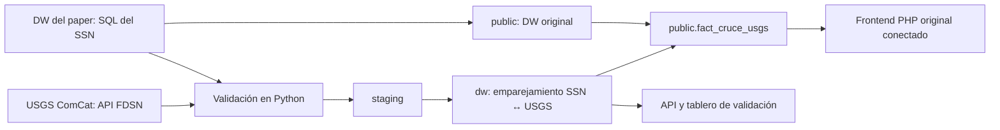

# Sismos: validación del catálogo SSN con USGS ComCat en el DW original

## Ampliación sísmica a Norteamérica: 26 de octubre de 2026

**Estado actual:** además de la demografía, se integraron eventos reales de USGS para 2020–2025 y magnitud ≥ 3.5.
Abrir http://localhost:8091/norteamerica/ o el botón **Sismos de Norteamérica** del menú original (8094).
El antiguo acceso `std.php` ahora redirige al mapa ampliado. Su implementación anterior permanece en
`original/src/std_mexico_legacy.php` como referencia histórica del artículo; los impactos imputados que muestra
esa pantalla histórica no se usan en el mapa nuevo.

### Datos reales y fuentes formales

| Uso | Institución / conjunto | Referencia y descarga |
|---|---|---|
| Eventos | U.S. Geological Survey, ANSS Comprehensive Earthquake Catalog (ComCat) | [DOI 10.5066/F7MS3QZH](https://doi.org/10.5066/F7MS3QZH); [API oficial FDSN](https://earthquake.usgs.gov/fdsnws/event/1/) |
| Límites de estados de EE. UU. | U.S. Census Bureau, Cartographic Boundary Files 2024, estados a escala 1:20,000,000 | [Página oficial](https://www.census.gov/geographies/mapping-files/2024/geo/carto-boundary-file.html); [ZIP SHP](https://www2.census.gov/geo/tiger/GENZ2024/shp/cb_2024_us_state_20m.zip) |
| Límites provinciales de Canadá | Government of Manitoba, *Canada Provinical boundaries*, catalogado en Open Government Canada | [Ficha federal](https://open.canada.ca/data/dataset/85efc01b-163f-ebba-2378-c43eadfb3b3f); [GeoJSON del portal gubernamental](https://geoportal.gov.mb.ca/api/download/v1/items/e46938cbb3e84c3688d03b8622d8f212/geojson?layers=0) |
| Población de las regiones | Census Bureau y Statistics Canada | Fuentes, DOI y filtros documentados en la sección demográfica siguiente |

Se intentó obtener límites directamente de Statistics Canada: la descarga SHP presentó una comprobación de seguridad
y los servicios REST devolvieron HTTP 500. Se utilizó el conjunto gubernamental de Manitoba publicado en el catálogo
federal; no se afirma que ese GeoJSON sea el SHP de Statistics Canada ni se evadió la comprobación.

### ETL y asignación territorial

`app/norteamerica.py` es el script ejecutable independiente. Descarga CSV anuales de ComCat con `eventtype=earthquake`,
`minmagnitude=3.5` y dos ventanas: latitud 14 a 84, longitud −180 a −50; y latitud 50 a 73, longitud 170 a 180 para
las Aleutianas al otro lado del antimeridiano. El periodo es `[2020-01-01, 2026-01-01)`, en UTC. Cada fin de consulta
se ajusta un milisegundo para no repetir el inicio del siguiente bloque. Si un bloque alcanza 20,000 eventos, se divide;
el archivo padre no se carga. Se exige encabezado CSV, coordenadas y magnitudes finitas, tipo earthquake, fechas dentro
del periodo e identificadores únicos. No se generan eventos de ejemplo.

Los límites estadounidenses se transforman de su CRS declarado a WGS84; los canadienses vienen declarados en EPSG:3857
y se transforman también a WGS84. La operación punto-en-polígono exige una única coincidencia. Los códigos estatales
`STATEFP` y la equivalencia de abreviaturas provinciales canadienses permiten enlazar con las regiones demográficas.
Se excluyen territorios estadounidenses distintos de los 50 estados y Washington D. C.; se excluye el polígono canadiense
nacional para no duplicar las provincias. Se incorporan Alaska y Hawái por pertenencia a EE. UU.; Hawái no pertenece
geográficamente al continente norteamericano.

Las fuentes originales, parámetros exactos y hashes quedan en `datos/norteamerica/procedencia.json`. Se conservan
los 12 CSV originales de esta descarga, los dos archivos de límites y el manifiesto. Los registros crudos se cargan en
`staging.usgs_norteamerica`; las columnas normalizadas en `public.fact_sismo_norteamerica`. El ETL sustituye únicamente
este catálogo acotado dentro de una transacción. No borra ni modifica el SSN original o el cruce anterior.

`public.fact_sismo_norteamerica` tiene PK `id_usgs` y FK `(pais,codigo)` a `public.dim_region_demografia`.
`public.v_sismo_norteamerica` relaciona cada evento asignado con la población de su región y el año UTC del evento,
usando como referencia el 1 de julio. `etl.norteamerica_carga` guarda el manifiesto y conteo de cada ejecución.

### Resultados de la carga comprobada

| Categoría | Eventos 2020–2025 |
|---|---:|
| Asignados a polígonos de Estados Unidos | 2,455 |
| Asignados a polígonos de Canadá | 245 |
| Sin asignación territorial única | 11,341 |
| Total regional de USGS conservado | 14,041 |

Los **11,341 sin asignar no son eventos falsos ni exclusivamente marítimos**: el rectángulo incluye mar y otros
países, y los límites generalizados pueden dejar puntos costeros fuera. Se conservan con país/región nulos; no se
asignan al país más cercano ni se les inventa población. El filtro «Área regional sin país asignado» permite verlos.
Los conteos US/CA son eventos dentro de estos polígonos, no todos los terremotos asociados a esos países o a sus costas.

### API, mapa e interfaz original

`app/norteamerica_web.py` registra `/norteamerica/` y `/api/norteamerica`, con `pais=US`, `CA`, `MX`, `TODOS` o
`SIN_ASIGNAR`, `anio=2020…2025` y `magnitud=3.5…10`. Rechaza años fuera de cobertura y valores no finitos.
`app/templates/norteamerica.html` dibuja puntos Leaflet desde PostgreSQL, con fuente, ID, fecha UTC, magnitud, profundidad
y población regional en el popup. Cada evento USGS enlaza a su ficha oficial. El color significa **magnitud**, no impacto.
El mapa se ajusta al conjunto visible y acomoda las longitudes positivas de las Aleutianas para evitar un encuadre mundial.

Se representan como máximo 4,000 puntos, ordenados por magnitud, fecha e ID. La tabla muestra hasta 100 registros;
el botón «Ver en mapa» abre el popup de cada fila, también con teclado. Los conteos y la serie mensual se calculan
sobre todo el filtro. Para ver los demás puntos, acotar filtros. La población
regional no se suma por evento ni se presenta como población expuesta. No se calculan daños o probabilidades de riesgo.

El filtro mexicano consulta el catálogo SSN ya integrado, con las fechas UTC reconstruidas. Conserva el ámbito del
proyecto original y su fecha de corte, no una nueva delimitación territorial de México. Las tres fuentes no constituyen
un catálogo homologado ni garantizan una detección comparable entre países. La vista regional usa USGS solo para US/CA
asignados y SSN para el ámbito mexicano; el área USGS sin asignar se consulta por separado y no se añade al combinado.

Ejemplos: en 2020 y M ≥ 3.5 se obtuvieron 643 eventos asignados a EE. UU. y 24 a Canadá. Con M ≥ 5 puede haber cero
en un país/año; reducir el filtro no significa inventar eventos, sino incluir magnitudes menores. Los grandes eventos
marítimos pueden quedar en el filtro sin asignación.

### Ejecución y comprobaciones

El arranque general `iniciar-docker.ps1` construye las dependencias nuevas y ejecuta demografía y Norteamérica antes
del ETL sísmico anterior. Para actualizar solo estos módulos, con la base ya encendida, desde la raíz:

```powershell
docker compose -f sismos-usgs/compose.yml -f sismos-usgs/compose.windows.yml build web
docker compose -f sismos-usgs/compose.yml -f sismos-usgs/compose.windows.yml run --rm --no-deps etl python demografia.py
docker compose -f sismos-usgs/compose.yml -f sismos-usgs/compose.windows.yml run --rm --no-deps etl python norteamerica.py
docker compose -f sismos-usgs/compose.yml -f sismos-usgs/compose.windows.yml up -d --no-deps web
docker compose -f sismos-usgs/compose.yml -f sismos-usgs/compose.windows.yml run --rm --no-deps -e URL_SISMOS=http://web:8000 etl python verificar_norteamerica.py
```

`norteamerica.py --descargar` actualiza los CSV del catálogo. Los límites se mantienen como las versiones conservadas;
los hashes del manifiesto detectan modificaciones de archivos. Se añadieron las dependencias Shapely 2.1.2, pyshp 2.3.1
y pyproj 3.7.2 a los requisitos de Docker y al entorno local.

`evidencia/norteamerica.json` registra **63 comprobaciones aprobadas**: hashes, conteos por bloque, correspondencia de
todos los eventos con los CSV, controles geográficos, reproducción de cada asignación, enlaces a población, conservación
del catálogo original y filtros/API/páginas. Se repitió la carga y los hechos siguen en 14,041 filas. Los originales
mantienen 319,592 sismos, 196,576 impactos imputados y 49,272 registros en la vista del cruce corregido.
Estas pruebas no son inspecciones de campo ni garantizan la exactitud física de todas las localizaciones publicadas.

Consulta para mostrar el warehouse:

```powershell
docker exec fa-sismos-db psql -U sismos -d sismos_dw -c "\d public.fact_sismo_norteamerica"
docker exec fa-sismos-db psql -U sismos -d sismos_dw -c "SELECT coalesce(pais,'SIN_ASIGNAR') AS pais,count(*) FROM public.fact_sismo_norteamerica GROUP BY 1;"
docker exec fa-sismos-db psql -U sismos -d sismos_dw -c "SELECT id_usgs,pais,region,magnitud,poblacion_region,url_fuente FROM public.v_sismo_norteamerica WHERE pais='CA' LIMIT 5;"
```

No se hizo commit ni push de esta ampliación; queda local para revisión.

Captura comprobada de un evento real canadiense, con su población regional y enlace USGS:
[`evidencia/norteamerica-canada.png`](../evidencia/norteamerica-canada.png).

## Ampliación demográfica: Estados Unidos y Canadá

Abrir http://127.0.0.1:8091/demografia/ o el enlace «Población de Estados Unidos y Canadá» del menú original (8094).
La vista consulta PostgreSQL mediante `/api/demografia?pais=CA&anio=2025`, con filtros de país y año.

Se incorporan **396 observaciones de población al 1 de julio de 2020–2025**: 50 estados de EE. UU. y Washington D. C.,
13 provincias/territorios canadienses y los dos totales nacionales. Los totales se separan del detalle regional para no
duplicarlos al sumar. En los 12 casos país/año, la suma de regiones coincide exactamente con el total oficial.

Fuentes nuevas:

- U.S. Census Bureau, *NST-EST2025-ALLDATA*, Vintage 2025. [Página oficial y metodología](https://www.census.gov/data/datasets/time-series/demo/popest/2020s-state-total.html).
  Se toman las columnas `POPESTIMATE2020` a `POPESTIMATE2025`, niveles `SUMLEV=010/040`; se excluyen Puerto Rico y agregados censales.
- Statistics Canada, *Table 17-10-0005-01, Population estimates on July 1, by age and gender*.
  [DOI: 10.25318/1710000501-eng](https://doi.org/10.25318/1710000501-eng).
  Se seleccionan `Total - gender`, `All ages`, unidad `Persons`, escala `units`, años 2020–2025.
  El campo original `STATUS` se conserva; no se interpreta un valor suprimido o ausente como cero.

`app/demografia.py` descarga los originales, genera `datos/demografia/poblacion_2020_2025.csv`, valida claves y totales,
y carga con upsert las tablas nuevas `public.dim_fuente_demografia`, `public.dim_region_demografia`
y `public.fact_poblacion_demografia`. La vista `public.v_poblacion_demografia` las relaciona; `etl.demografia_carga`
guarda el manifiesto de cada extracto distinto. Se conservan fecha de referencia, códigos de origen, URLs y SHA-256
en `datos/demografia/procedencia.json`. Se conservan el CSV original estadounidense, el ZIP canadiense (aprox. 4 MB),
el extracto validado y su manifiesto para cargar y comprobar al clonar sin volver a descargarlos.

El módulo se ejecuta automáticamente al iniciar el ETL de sismos, incluso si el cruce ya está cargado.
También se puede cargar por separado, sin repetir el emparejamiento ni tocar los datos originales:

```powershell
docker compose -f sismos-usgs/compose.yml -f sismos-usgs/compose.windows.yml run --rm --no-deps etl python demografia.py
```

Añadir `--descargar` a `demografia.py` para actualizar los archivos oficiales y el extracto. Sin esa opción, se verifica
el hash del extracto conservado y se reutiliza. Las recargas no duplican observaciones.

Verificación independiente del extracto, PostgreSQL, 12 totales oficiales y endpoints (22 comprobaciones):

```powershell
docker compose -f sismos-usgs/compose.yml -f sismos-usgs/compose.windows.yml run --rm --no-deps -e URL_SISMOS=http://web:8000 etl python verificar_demografia.py
```

Este control descarga el ZIP canadiense si no está disponible localmente. Si la fuente cambió de versión y su hash ya
no coincide con el manifiesto, falla explícitamente: una actualización debe hacerse con `demografia.py --descargar`.

Consulta para enseñar las tablas (desde PowerShell):

```powershell
docker exec fa-sismos-db psql -U sismos -d sismos_dw -c "SELECT pais, anio, COUNT(*) AS regiones, SUM(poblacion) AS personas FROM public.v_poblacion_demografia WHERE nivel='region' GROUP BY pais, anio ORDER BY pais, anio;"
```

**Alcance:** población total de todas las edades, no desglose por sexo, edad ni datos económicos. Son estimaciones
oficiales revisables, no conteos censales anuales. Esta población es contexto regional; no demuestra exposición ni
afectación por un sismo. No se sobrescribe la población mexicana del original. La ampliación sísmica del 26 de octubre,
documentada arriba, añade la asignación territorial de eventos USGS y su relación con esta población. No se infiere
un país a partir del texto libre de USGS ni se fabrican impactos.

### Registro de implementación del 25 de octubre de 2026

El trabajo de esta fase fue la **demografía de Estados Unidos y Canadá**, implementada localmente con apoyo de Codex.
La ampliación del catálogo sísmico se incorporó posteriormente, el 26 de octubre, y se documenta arriba.
Agua y obras no se modificaron durante esta ampliación.

#### Proceso realizado

1. Se revisaron el esquema original, el ETL sísmico, la configuración Docker y las interfaces existentes.
2. Se localizaron y descargaron el CSV oficial estadounidense y el ZIP oficial canadiense citados arriba.
3. Se eligió una medida comparable: población total, todas las edades, al 1 de julio, para 2020–2025.
4. Se convirtió la estructura estadounidense de columnas por año a filas por región/año. Del archivo canadiense
   se seleccionaron los años y categorías indicados, conservando sus códigos geográficos y estado de publicación.
5. Se generó un extracto UTF-8 de 396 filas y un manifiesto con URLs, filtros, fecha de extracción, tamaños y hashes.
6. Se validaron claves únicas, valores positivos, cobertura y coincidencia de las sumas regionales con los totales
   nacionales. Un dato ausente o una discrepancia hace fallar la carga; no se sustituye por cero.
7. Se crearon tablas nuevas en la misma base `sismos_dw`, con claves primarias y foráneas. Se cargaron con upsert:
   la combinación país, código y fecha identifica una observación y evita duplicados al repetir la carga.
8. Se añadió una API y una página que consultan las tablas locales, con filtros de país y año. Se enlazó desde
   el tablero sísmico y desde el menú PHP original.
9. Se probó la carga tanto con Python local como dentro de Docker. Se reconstruyó el servicio web de sismos,
   se comprobó el cambio de país en el navegador y se guardaron resultados de verificación y una captura.

#### Tablas y relaciones

| Objeto | Contenido | Clave / relación |
|---|---|---|
| `public.dim_fuente_demografia` | Dos fuentes: institución, título, URL, DOI cuando existe y hash del original | PK `pais` |
| `public.dim_region_demografia` | 66 geografías: 64 regiones y dos totales nacionales | PK `(pais,codigo)`; FK a la fuente |
| `public.fact_poblacion_demografia` | 396 observaciones de población y estado de publicación original | PK `(pais,codigo,fecha_referencia)`; FK a la región |
| `public.v_poblacion_demografia` | Vista de hechos, regiones y fuentes, con año de referencia | JOIN por país y código |
| `etl.demografia_carga` | Registro de cada extracto distinto cargado, su hash, cantidad y manifiesto | No añade otra entrada al repetir el mismo extracto |

El modelo demográfico tiene sus propias claves. En la fase del 25 de octubre todavía no había relación territorial;
la ampliación del 26 añade la FK desde `fact_sismo_norteamerica` y el JOIN en `v_sismo_norteamerica`.
La fecha de referencia es el 1 de julio del año de la estimación; no es
la fecha de un sismo. La vista conserva los totales nacionales con `nivel='pais'` y las regiones con `nivel='region'`.
Para calcular población nacional mediante suma, usar solo `nivel='region'` y un único año. No sumar poblaciones
de varios años para describir cuántas personas viven en un país.

| País | Geografías por año | Observaciones 2020–2025 | Total nacional 2025 |
|---|---:|---:|---:|
| EE. UU. | 50 estados + DC + total nacional = 52 | 312 | 341,784,857 personas |
| Canadá | 13 provincias/territorios + total nacional = 14 | 84 | 41,608,982 personas |
| Ambos | 66 | 396 | Los países se consultan por separado |

Los totales anteriores corresponden a las versiones de las fuentes descargadas para esta entrega. Se conservan
las versiones y hashes; una publicación posterior puede revisar las estimaciones.

#### Archivos añadidos y modificados

Todas las rutas siguientes son relativas a la raíz del repositorio.

| Ruta | Función |
|---|---|
| `sismos-usgs/app/demografia.py` | Extracción, validación, DDL y carga demográfica independiente |
| `sismos-usgs/app/demografia_web.py` | Blueprint Flask con `/demografia/` y `/api/demografia` |
| `sismos-usgs/app/templates/demografia.html` | Selector de país/año, tabla regional, participación y referencias |
| `sismos-usgs/app/verificar_demografia.py` | Verificación de archivos, base y servicios |
| `sismos-usgs/app/etl.py` | Invoca el módulo demográfico antes del proceso sísmico existente |
| `sismos-usgs/app/web.py` | Registra el blueprint demográfico |
| `sismos-usgs/app/templates/index.html` | Añade enlace desde el tablero |
| `sismos-usgs/original/src/demografia.php` | Redirige a la página usando la URL configurada del tablero |
| `sismos-usgs/original/src/vista.html` | Añade enlace al menú original |
| `sismos-usgs/datos/demografia/` | CSV de Census, ZIP de Statistics Canada, extracto y `procedencia.json` |
| `evidencia/demografia.json` | Resultado de 22 comprobaciones ejecutadas |
| `evidencia/demografia-us.png` | Captura de la vista de Estados Unidos |
| `README.md`, `sismos-usgs/README.md`, `ENTREGA.md` | Acceso, documentación técnica y guía de demostración |

No se añadieron dependencias de Python ni se modificó la configuración de puertos. La modificación anterior del
límite de 2,000 puntos en `datos_sismicos.php` pertenece a otra corrección; no forma parte de este trabajo.

#### Arranque y revisión por el compañero

Con Docker Desktop iniciado, desde la raíz del repositorio:

```powershell
powershell -NoProfile -ExecutionPolicy Bypass -File .\iniciar-docker.ps1
```

Ese comando construye las imágenes y arranca los proyectos existentes. Para revisar únicamente esta ampliación
cuando la base de sismos ya está levantada:

```powershell
docker compose -f sismos-usgs/compose.yml -f sismos-usgs/compose.windows.yml build web
docker compose -f sismos-usgs/compose.yml -f sismos-usgs/compose.windows.yml run --rm --no-deps etl python demografia.py
docker compose -f sismos-usgs/compose.yml -f sismos-usgs/compose.windows.yml up -d --no-deps web
```

La imagen `fa-sismos-app` es compartida por ETL y web. Estos comandos cargan las tablas nuevas y actualizan
la web sin repetir el cruce SSN/USGS. Abrir http://localhost:8091/demografia/?pais=US&anio=2025 y cambiar a Canadá
y a otro año. La página se renderiza en el servidor y consulta PostgreSQL; no contiene una lista de población
escrita manualmente en el HTML.

Para enseñar estructura y registros desde PowerShell:

```powershell
docker exec fa-sismos-db psql -U sismos -d sismos_dw -c "\d public.fact_poblacion_demografia"
docker exec fa-sismos-db psql -U sismos -d sismos_dw -c "SELECT pais,codigo,nombre,anio,poblacion FROM public.v_poblacion_demografia WHERE nivel='region' AND anio=2025 ORDER BY pais,nombre LIMIT 10;"
docker exec fa-sismos-db psql -U sismos -d sismos_dw -c "SELECT pais,COUNT(*) FROM public.fact_poblacion_demografia GROUP BY pais;"
```

#### Evidencia y límites de las verificaciones

La ejecución registrada en `../evidencia/demografia.json` terminó el **25 de octubre de 2026 a las 18:53,
hora de Ciudad de México** (el JSON registra `2026-10-26T00:53:06.277663+00:00`, en UTC).
Pasaron las 22 comprobaciones:

- Coincidencia exacta de las 396 observaciones entre extracto y PostgreSQL y ausencia de claves duplicadas: 2.
- SHA-256 de los dos originales contra el manifiesto: 2.
- Coincidencia entre API, sumas regionales y totales nacionales leídos de los originales para los 12 país/año: 12.
- Rechazo de país desconocido, año fuera del periodo y año no numérico: 3.
- Página de cada país con datos y fuente: 2.
- Enlace al módulo desde el tablero sísmico: 1.

Además se repitió manualmente la carga: quedaron 396 observaciones y un registro de extracto en
`etl.demografia_carga`. Se verificó el enlace desde PHP y se conservaban 319,592 sismos originales,
196,576 hechos de impacto originales y 49,272 registros en la vista del cruce corregido.
Esto documenta las comprobaciones de esta ampliación; no significa que se hayan repetido las otras 62
verificaciones de agua, obras y sismos de la entrega anterior.

#### Seguimiento de la integración sísmica

- Realizado el 26 de octubre: carga de eventos USGS, asignación mediante límites gubernamentales y relación con
  población del mismo año/región. Véase la sección de Norteamérica.
- No multiplicar población por el número de eventos al analizar los resultados.
- Si se necesita exposición sísmica, definir un método y fuentes adecuados. La población de todo un estado o
  provincia no equivale a personas afectadas por un evento.

Esta ampliación no incorpora desglose demográfico por edad/sexo ni actualiza economía. Tampoco amplía agua u obras.
Al documentar este trabajo no se realizó commit ni push; los archivos quedan locales para revisión del equipo.

## Ejecutar

En Windows, usar `iniciar-docker.ps1` desde la raíz; en Linux o macOS, `./iniciar.sh`. Abre http://127.0.0.1:8091 (tablero de validación) y http://127.0.0.1:8094 (interfaz original del artículo).

Alternativa completamente en Docker, desde esta carpeta:

```sh
docker compose up -d --build
docker compose logs -f etl
```

La web y la interfaz original esperan a que el ETL termine correctamente. Los esquemas `etl`, `staging` y `dw` se inicializan al crear el volumen. El esquema original `public` se carga una sola vez con los scripts SQL del proyecto original. Para volver a cargar todo se usa `FORZAR_ETL=1 docker compose up etl`. Las versiones originales están documentadas en `../PROCEDENCIA_ORIGINALES.md`.

## Recorrido de los datos



El DW original se conserva con sus claves: `dim_sismos`, `dim_tiempo`, `dim_zonas`, `dim_economia` y `fact_impacto_sismos_imputed`. El nuevo hecho `public.fact_cruce_usgs` se enlaza con claves foráneas a `public.dim_sismos` y a `public.dim_tiempo`. En el modelo original cada sismo tiene su propio registro de tiempo (`id_tiempo = id_sismo`). `public.dim_fuente_sismo` registra las dos fuentes con su cita y su DOI.

El emparejamiento se calcula en `dw` (función `dw.fn_emparejar`) y se repite para dos variantes de fecha:

- `corregida`: el instante UTC reconstruido. Es la que se usa en el análisis.
- `dw_original`: la marca de tiempo tal como viene en el DW del paper. Se conserva como diagnóstico.

Un par requiere cercanía en tiempo (±30 s), en distancia (100 km) y en magnitud (|ΔM| ≤ 1). Antes de 1964 las tolerancias son ±120 s y 250 km, porque los catálogos históricos redondean. La asignación es uno a uno.

Los sismos del USGS sin contraparte en el SSN quedan en `dw`. No se añaden filas inventadas a `public.dim_sismos`.

## Interfaz original conectada

El servicio `original` sirve el frontend PHP del artículo, con PHP 8.2 y Apache, sobre la misma base. Los cambios están marcados con el comentario `fuentes-alternas`:

- `config_local.php` lee las credenciales del entorno. Las páginas originales tenían credenciales fijas y distintas entre sí, incluso `localhost` en `datos_sismicos.php`.
- Los enlaces de navegación apuntaban a páginas que no existen en el repositorio (`mexico.php`, `poblacion.php`, `riesgo.php` y `resultado_final.php`). Ahora llevan a `vista.html`, `std2.php` y `std.php`, y el último se retiró.
- `sismos.php` y `datos_sismicos.php` muestran en cada sismo si ComCat lo confirma, con su magnitud y la distancia entre epicentros. `sismos.php` también suma los confirmados del mapa.
- `index.php` redirige al menú `vista.html`, y `validacion.php` abre el tablero de validación.
- Los mapas económicos se empatan por nombre de entidad. `std3.php` buscaba la clave INEGI en `dim_economia.entidad`, que no la contiene (Aguascalientes = 5797), y quedaba vacío; `aeconomica.php` comparaba nombres sin acentos y dejaba fuera 9 estados, entre ellos la Ciudad de México. Además, `std3.php` colorea por cuantiles del indicador elegido (cuatro entidades por color), porque su escala fija de 10,000 a 1,000,000 dejaba casi todos los estados en el mismo rojo, `aeconomica.php` usa quintiles en lugar de cinco tramos iguales, que con la Ciudad de México muy por encima dejaban casi todo en el primer color, y formatea bien los números de la leyenda.
- `sismos.php` y `sismo.php` usaban el mapa base de CARTO, que ahora exige una clave de API: en lugar del mapa devuelve teselas con la leyenda «API KEY REQUIRED». Se sustituyó por OpenStreetMap, que ya usan las demás páginas del original.

`/api/original` del tablero devuelve los conteos del DW original y del cruce integrado.

## Fuentes

U.S. Geological Survey. (2017). *Advanced National Seismic System (ANSS) Comprehensive Catalog* [Conjunto de datos]. U.S. Geological Survey. https://doi.org/10.5066/F7MS3QZH

Villa Vargas, J. M., Hurtado Avilés, G., y Climent Hernández, J. A. (2026). Cuando México tiembla: la historia contada por los datos. *AZCATL Revista de Divulgación de la Ciencia, la Ingeniería y la Innovación, 4*(6), 28–33. https://doi.org/10.24275/AZC2026E1004

El USGS se consulta por la API FDSN (`https://earthquake.usgs.gov/fdsnws/event/1/`). Se usa el rectángulo de México del pipeline del paper, desde 1900 y con M ≥ 3.5. La descarga se divide en bloques que no superan el límite de 20,000 eventos por consulta. Los bloques cerrados se guardan en `datos/usgs/` y el año en curso se vuelve a descargar en cada carga.

Los SQL del SSN se toman del commit `8569667` del repositorio original y se guardan en `datos/ssn/`. Sus SHA-256 están en `../evidencia/verificacion.json`.

## Resultado comprobado

- El DW original queda completo: 319,592 sismos, 319,592 registros de tiempo, 196,576 hechos de impacto, 32 zonas y 32 registros económicos.
- Pasan la validación 315,497 sismos del SSN y 24,994 del USGS.
- Con las fechas corregidas y las soluciones independientes, hay 7,884 pares. La distancia mediana entre epicentros es 19.2 km y ΔM = −0.12 ± 0.27.
- `public.fact_cruce_usgs` integra 49,272 registros con la variante corregida y 48,159 con la original. Cada uno está enlazado a su sismo y a su tiempo originales.

**Hallazgo.** El DW une la *fecha local* del SSN con la *hora UTC*. Los sismos ocurridos entre las ~18:00 y las 23:59, hora del centro, quedan con un día de menos: son 74,927 (23.7 %). Por ejemplo, el M8.2 de Tehuantepec aparece el 7 de septiembre de 2017; ocurrió el 8 a las 04:49 UTC, y ComCat lo confirma como `us2000ahv0` a 36.4 km. Con la fecha corregida, la parte de los sismos M ≥ 4.5 del SSN que confirma el USGS sube de 64.2 % a 83.5 %, contando todas las soluciones de ComCat.

## Límites

- ComCat también republica soluciones del propio SSN: red `UNM`, Instituto de Geofísica de la UNAM. Esos pares coinciden casi por construcción. Por eso el tablero, por omisión, solo cuenta las soluciones calculadas por otras redes.
- Un par indica que dos redes registraron el mismo evento. No valida por sí mismo la magnitud del SSN: las escalas difieren (Mw, mb, ML) y la diferencia se presenta según el tipo de magnitud.
- El rectángulo incluye partes del sur de EE. UU., de Guatemala y del océano. Se usa el mismo filtro del paper, no polígonos oficiales.
- El catálogo del SSN que se valida es la versión del DW del paper (hasta abril de 2025), no el catálogo vigente del SSN.
- El mapa base y las bibliotecas del frontend requieren Internet. Las cifras salen de la base local.
